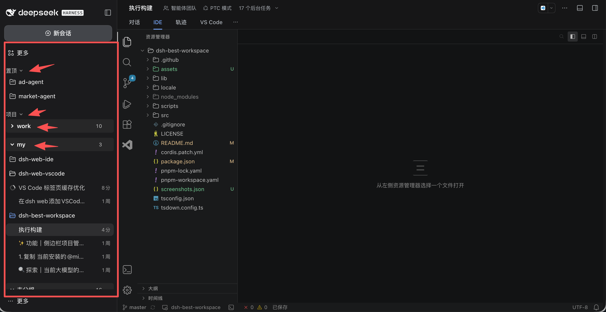

<div align="center">

  # DSH Best Workspace

  **把 DSH Web 的左侧栏变成 Codex 风格的项目 / 会话树**

  [](LICENSE)
  [](https://www.npmjs.com/package/@zhaoyang10/dsh-best-workspace)
  [](https://gitee.com/fengzhaoy/dsh-best-workspace)

</div>

> 社区维护的 DeepSeek Harness（DSH）界面插件，不是 DeepSeek 官方产品。

插件只做两件事：**重绘 DSH Web 的左侧栏**（Codex 风格的项目 / 会话树），以及**给会话输入框加上 ↑↓ 翻历史**。对话视图、右侧栏和宿主渲染的其他区域保持原样。



## 功能

### 左侧栏

- **项目 / 会话树**：会话挂在所属项目之下，并行多个仓库时依然清晰。
- **三个可折叠分区**：**置顶**、**项目**、**最近**，各自记住展开状态。
- **项目分组**：新建、重命名、删除分组，项目可在分组间移动；不属于任何分组的归入**未分组**。
- **拖拽排序**：项目、项目内会话、分组都可拖动重排，拖进**置顶**即置顶，落点有指示线。
- **会话实时状态**：运行中指示、未读圆点、待处理警告徽标（审批 / 回答 / 计划审阅），并显示相对时间与项目副标题。
- **右键菜单**：
  - 会话：重命名、标记已读 / 未读、归档、分叉、移动到其他项目、打开工作目录、复制 ID / 标题 / 路径、删除。
  - 项目：置顶 / 取消置顶、重命名、移动到分组、打开项目目录、归档全部会话、删除项目。
- **搜索**：悬停**项目**分区标题行出现放大镜，点击展开搜索框，按标题实时过滤项目与会话（`Esc` 关闭）。
- **长列表分页**：会话超过首屏后通过**展开显示**加载。
- **主题跟随**：配色全部取自宿主主题令牌，浅色 / 深色自动切换。
- **设置持久化**：置顶与分组保存在宿主侧，重启、换浏览器都不丢。

### 输入框

- **↑↓ 翻历史**：输入框为空时按 <kbd>↑</kbd> 召回上一条已发送消息，<kbd>↓</kbd> 往回翻，翻到底自动回到原始草稿。
- **按目录独立记录**：同一目录下的所有会话共享一份历史，每个目录最多保留 200 条（最多 20 个目录，总量 1 MB）。
- **不打扰原生交互**：中文输入法组词、光标在文本中间、按住 Ctrl / Cmd / Alt / Shift、消息提交中、有附件、菜单打开时，按键行为保持原样。
- **视觉提示**：占位符右侧显示「↑↓ 翻历史」，窄屏自动隐藏。

## 安装

### 交给 agent 安装（推荐）

把下面这句话发给任何能在你机器上执行命令的 agent，把 `web` 换成你的 profile 名：

```text
把 DSH 插件 @zhaoyang10/dsh-best-workspace 安装到我本地的 web profile 中，执行：dsh plugin --profile web add @zhaoyang10/dsh-best-workspace@latest --registry=https://registry.npmjs.org/。然后运行 dsh --profile web --dump-config，确认合成后的配置里包含 dsh-best-workspace 一行，并说明如何重启 DSH 以及如何使用这个侧栏。
```

### 手动安装

```bash
dsh plugin --profile web add @zhaoyang10/dsh-best-workspace@latest --registry=https://registry.npmjs.org/
dsh --profile web --dump-config | grep dsh-best-workspace
```

重启 `dsh web`，然后硬刷新浏览器标签页（<kbd>Cmd</kbd>+<kbd>Shift</kbd>+<kbd>R</kbd>）。卸载同样简单：

```bash
dsh plugin --profile web remove @zhaoyang10/dsh-best-workspace
```

## 冲突与共存

插件独占 `sidebar.workspaces` 槽位，**同一 profile 只能启用一个侧栏树插件**。安装前请先停用或卸载其他同类插件：

```bash
dsh plugin --profile web remove ds-bot          # 以及其他接管左侧栏的插件
```

停用而不卸载也可以。占用**右侧**栏或其他槽位的插件（如 `dsh-better-sidebar`）不冲突，可继续使用。

安装后插件会向 profile 的插件树增加一行，并应用 [cordis.patch.yml](cordis.patch.yml)：

- 挂载 `dsh-best-workspace`，接管 `sidebar.workspaces`；
- 向 `sidebar.panellist.actions` 贡献菜单项；
- 停用 `directory-picker`（macOS + loopback 下原生 `osascript` 可能挂死），改用官方 `directory-picker-browse` 后端与界面。

因此**添加工作区**打开的是进程内目录浏览器，而非系统对话框。

## 使用

| 目标 | 操作 |
| --- | --- |
| 打开会话 | 在树中点击该会话 |
| 搜索 | 悬停**项目**标题行，点击放大镜输入关键词 |
| 置顶项目 | 拖进**置顶**分区，或右键选择**置顶** |
| 分组项目 | 从**项目**分区标题新建分组，再用**移动到分组** |
| 调整顺序 | 拖动项目、会话或分组 |
| 重命名 | 对项目、分组或会话使用**重命名** |
| 清理项目 | 右键项目 → **归档全部会话** 或 **删除** |
| 翻历史 | 输入框为空时按 <kbd>↑</kbd> / <kbd>↓</kbd> |

## 数据与隐私

- **置顶与分组**通过宿主端点 `/api/dsh-best-workspace/preferences`（`GET` / `HEAD` / `PUT`）持久化，写入 profile 目录下的 `.dsh-best-workspace-preferences.json`，串行写入 + 原子重命名，请求体上限 32 KB，字段逐个校验。
- **旧存档迁移**：升级后首次启动会自动把旧文件名（codex-ui 时代）里的置顶与分组复制到新文件，**旧文件保留不删**——降级回旧版本时配置依然在。浏览器 localStorage 的置顶、分组、展开状态同理，均按需迁移。
- **未读标记与输入历史**只存在当前浏览器的 `localStorage`，不跨浏览器 / 机器同步。输入历史按会话目录分桶，可随时清除浏览器数据。
- **搜索**完全在本地完成，不发请求、不写偏好文件。
- 插件**不写会话记录**，也不改动项目文件；归档、删除、分叉、移动都是宿主公共服务操作。
- 偏好端点复用宿主 `connection` 服务的 host / origin 校验，服务不可用时直接拒绝而非放行。

## 常见问题

**置顶和未读能跨重启保留吗？** 置顶与分组在宿主侧，重启、换浏览器都保留；未读和输入历史在浏览器本地。

**删除项目会删磁盘文件吗？** 不会，只是从侧栏移除，项目目录与会话都还在。

**安装后界面没变化？** 依次确认：profile 是否一致、是否重启过 `dsh web`、标签页是否硬刷新。再执行 `dsh --profile web --dump-config` 确认存在 `dsh-best-workspace` 一行。

**为什么「添加工作区」是应用内浏览器？** 见上面的 macOS 兼容处理说明。

**已发送的消息没有被记进历史？** 历史在发送成功后采集；升级后需要先发一条新消息，或清空输入框后按 <kbd>↑</kbd> 验证。

## 开发

```
src/
  index.ts                 Host 侧：工作区偏好端点
  client/
    index.ts               客户端入口：导出 apply / inject
    sidebar/legacy-app.ts  侧栏与输入历史实现（槽位、树、菜单、键位）
locale/{en,zh}.json        DSH 插件设置页展示的元数据（meta.title / description）
cordis.patch.yml           profile 启动时应用的 bundle 补丁
```

```bash
pnpm install
pnpm run build        # tsc --noEmit && tsdown
```

构建产出 `lib/index.mjs`、`lib/index.d.mts`、`lib/client.js`。`lib/` 提交进仓库，CI 会在重新构建结果与提交内容不一致时失败。React 与 `@deepseek-ai/dsh-client-ui-primitives` 不打包，运行时由宿主模块表提供。

DSH 包版本只在 [pnpm-workspace.yaml](pnpm-workspace.yaml) 的 `catalog:` 中声明一次，升级 DSH 只改这一处。

本地试用当前代码：

```bash
dsh plugin --profile web add link:"$PWD"
```

端到端校验（隔离 profile + Chrome 驱动）：

```bash
node scripts/verify-directory-flow.mjs   # 需要 playwright 与本地 Chrome
```

新增能力请复用 DSH 现有的槽位与公共服务，不要读取宿主私有 DOM，也不要直接写会话记录。

## 许可证

[Apache License 2.0](LICENSE)
