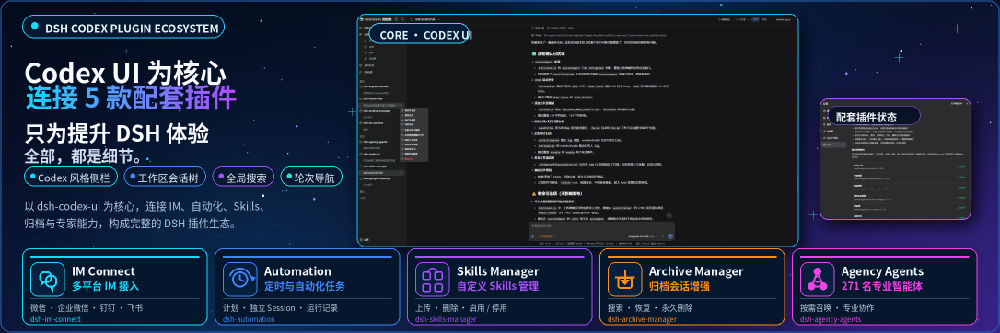

<p align="center">
  
</p>

<div align="center">

  # DSH Codex Sidebar

  **Turn your DSH Web workspaces and conversations into one Codex-style sidebar tree**

  [简体中文](README.zh-CN.md) · [Apache-2.0](LICENSE)

  [](LICENSE)
  [](https://www.npmjs.com/package/@zhaoyang10/dsh-best-workspace)
  [](https://gitee.com/fengzhaoy/dsh-best-workspace)
  [](https://nodejs.org/)

</div>

> DSH Codex Sidebar is a community-maintained interface plugin for DeepSeek Harness (DSH), not an official DeepSeek AI product.

This plugin does exactly one thing: **it redraws the left sidebar in DSH Web**. Your left navigation becomes a Codex-style workspace/session tree, so conversations across multiple projects are easy to scan and manage at a glance. The rest of the interface stays as the host renders it.

## Features

- **Workspace/session tree**: conversations are grouped by workspace; workspaces can be pinned, expanded or collapsed, and reordered by dragging.
- **Native workspace capabilities**: adding and removing workspaces and opening project folders still go through the host, with no copied data and no writes to conversation records.
- **Conversation management**: rename, pin, mark unread, archive, and delete.
- **Context menus**: common workspace and conversation actions are available from right-click menus.
- **Client-side only**: the plugin registers a sidebar view and nothing else; disabling or uninstalling it restores the official sidebar.

## Host compatibility

Host compatibility: Full DeepSeek Harness `0.2.x` line (`>=0.2.0-rc.1 <0.3.0-0`). The plugin is developed against `0.2.x`, with development dependencies pinned to `0.2.1-rc.3`; subsequent `0.2.x` releases, alphas, and RCs pass the version gate, while legacy versions and breaking changes in the `0.3.0` generation are rejected.

## Prerequisites

- A working DeepSeek Harness Web installation with `dsh` available in PowerShell.
- Examples use the `web` profile; replace it with the target profile.
- Node.js must satisfy `^22.19.0 || >=24.0.0`. Installing from source also requires pnpm.

## Conflicts and coexistence

This plugin owns the `sidebar.workspaces` slot, and only one sidebar-tree plugin can own that slot in a profile. Before installing, uninstall or disable existing sidebar plugins, including:

- `@michengai/dsh-codex-ui`
- `ds-bot`
- any other sidebar plugin that also takes over `sidebar.workspaces`

For the `web` profile, uninstall them with:

```powershell
dsh plugin --profile web remove @michengai/dsh-codex-ui
dsh plugin --profile web remove ds-bot
```

Disabling instead of uninstalling is fine, as long as a profile never enables two sidebar-tree plugins at the same time. After installing, restart `dsh web` and refresh the browser so the new sidebar takes effect.

## Installation

Choose agent-assisted or manual installation below. Both use the same command, requesting the latest version from the official npm registry.

### Ask an agent to install it (recommended)

Send the prompt below to any agent that can run terminal commands on your computer. Replace `web` with your actual profile. Once installed, use the plugin in DSH.

```text
Install the DSH plugin @zhaoyang10/dsh-best-workspace into my local web profile by running: dsh plugin --profile web add @zhaoyang10/dsh-best-workspace@latest --registry=https://registry.npmjs.org/. Then run dsh --profile web --dump-config, confirm the configuration includes codex-ui, and explain how to reload DSH and start using the plugin.
```

### Install manually

```powershell
[Console]::OutputEncoding = [System.Text.Encoding]::UTF8
$OutputEncoding = [System.Text.Encoding]::UTF8
dsh plugin --profile web add @zhaoyang10/dsh-best-workspace@latest --registry=https://registry.npmjs.org/
dsh --profile web --dump-config
```

Restart DSH Web and hard-refresh the browser (usually `Ctrl+Shift+R`). Once the new sidebar appears, you are ready to use it. Disabling or uninstalling restores the official sidebar. If the profile `cordis.patch.yml` still has `disabled: true` for `ui-sidebar` or `ui-settings-general`, delete those rows and reload.

## Usage

Open DSH Web. The left navigation is rendered by this plugin.

| Goal | Action |
| --- | --- |
| Start a conversation | Select **New task**, or use a workspace **+** / **New conversation** action. |
| Collapse the sidebar | Use the header panel button. The expand control stays on the collapsed rail. |
| Pin a workspace | Drag it into **Pinned**, or choose **Pin workspace** from the context menu. |
| Reorder items | Drag a workspace or conversation to its new position. |
| Manage a conversation | Use the conversation context menu to rename, pin, mark unread, archive, or delete it. |
| Add or remove a workspace | Use **Add workspace** in the sidebar, or the remove action in a workspace context menu. |

## FAQ

### Do pinned and unread states persist?

Pinned state is saved in your DSH configuration and survives restarts. Unread markers are stored only in the current browser and do not sync across browsers.

### Does removing a workspace delete local files?

No. Removing a workspace only unregisters it; it never deletes the project folder or any conversation records.

### What if nothing changes after installation?

Check that the installation profile matches the one running DSH Web, then restart DSH Web and hard-refresh the browser. Run `dsh --profile web --dump-config` to check that `codex-ui` is mounted.

## Development

This package contains only the sidebar: the host entry is [src/index.ts](src/index.ts), the client entry is [src/client/index.ts](src/client/index.ts), and the sidebar implementation lives in [src/client/sidebar](src/client/sidebar).

After changing source, run `pnpm build` to regenerate `lib`, then install from the local directory to verify:

```powershell
[Console]::OutputEncoding = [System.Text.Encoding]::UTF8
$OutputEncoding = [System.Text.Encoding]::UTF8
pnpm install --frozen-lockfile
pnpm build
dsh plugin --profile web add .
```

New features should reuse existing DSH slots and public services. Do not depend on private host DOM or write conversation records.

## License

This project is licensed under [Apache License 2.0](LICENSE).
