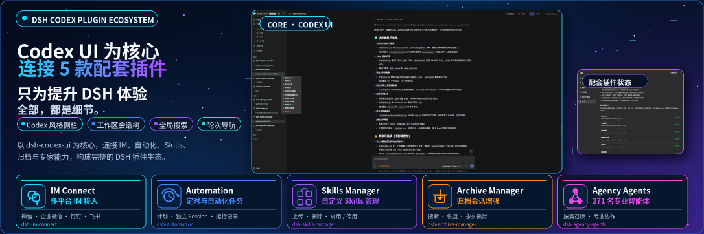

<p align="center">
  
</p>

<div align="center">

  # DSH Codex Sidebar

  **把 DSH Web 的工作区与会话，整理成一棵 Codex 风格的左侧栏树**

  [English](README.md) · [Apache-2.0](LICENSE)

  [](LICENSE)
  [](https://www.npmjs.com/package/@zhaoyang10/dsh-best-workspace)
  [](https://gitee.com/fengzhaoy/dsh-best-workspace)
  [](https://nodejs.org/)

</div>

> DSH Codex Sidebar 是社区维护的 DeepSeek Harness（DSH）界面插件，并非 DeepSeek AI 官方产品。

本插件只做一件事：**重绘 DSH Web 的左侧边栏**。它把左侧导航改造成一棵 Codex 风格的工作区/会话树，让多个项目下的会话一眼可辨、随手可管；其余界面保持宿主原样。

## 功能

- **工作区/会话树**：按工作区分组展示会话，工作区可置顶、展开或折叠，并支持拖拽调整顺序。
- **原生工作区能力**：添加、移除工作区以及打开项目目录仍走宿主原生能力，不复制数据、不修改会话记录。
- **会话管理**：重命名、置顶、标记未读、归档、删除。
- **右键菜单**：工作区与会话都可以通过右键菜单完成常用操作。
- **纯客户端渲染**：只注册侧栏视图，禁用或卸载插件后会自动回退到官方侧栏。

## 宿主兼容性

宿主支持范围：DeepSeek Harness `0.2.x` 全系列（`>=0.2.0-rc.1 <0.3.0-0`）。本插件面向 `0.2.x` 开发，开发依赖钉在 `0.2.1-rc.3`；后续日常小版本、alpha 与 RC 由版本门放行，早期版本与 `0.3.0` 代际破坏性更新会被拦截。

## 前置条件

- 已可正常运行 DeepSeek Harness Web，且可在 PowerShell 中使用 `dsh`。
- 以下示例使用 `web` profile；请替换为实际目标 profile。
- 运行环境需满足 Node.js `^22.19.0 || >=24.0.0`；从源码安装还需要 pnpm。

## 冲突与共存

本插件占用 DSH 的 `sidebar.workspaces` 槽位，同一 profile 中只能有一个侧栏树插件接管该槽位。安装前请先卸载或停用已有的侧栏插件，至少包括：

- `@michengai/dsh-codex-ui`
- `ds-bot`
- 其它同样接管 `sidebar.workspaces` 的侧栏插件

以 web profile 为例，卸载命令：

```powershell
dsh plugin --profile web remove @michengai/dsh-codex-ui
dsh plugin --profile web remove ds-bot
```

也可以只停用而不卸载，只要保证同一 profile 不**同时启用**两个侧栏树插件即可。安装完成后重启 `dsh web` 并刷新浏览器，新的侧栏才会生效。

## 安装

下面提供 Agent 代装和手动安装两种方式，使用同一条安装命令。示例指定最新版和官方 npm 源。

### 让 Agent 帮你安装（推荐）

把下面这段话发给任意能够执行本机终端命令的 Agent。将 `web` 替换为实际使用的 profile；安装完成后，在 DSH 中使用本插件。

```text
请将 DSH 插件 @zhaoyang10/dsh-best-workspace 安装到本机 web profile，执行：dsh plugin --profile web add @zhaoyang10/dsh-best-workspace@latest --registry=https://registry.npmjs.org/。安装后执行 dsh --profile web --dump-config，确认配置包含 codex-ui，并告诉我如何重新加载 DSH 和开始使用。
```

### 手动安装

```powershell
[Console]::OutputEncoding = [System.Text.Encoding]::UTF8
$OutputEncoding = [System.Text.Encoding]::UTF8
dsh plugin --profile web add @zhaoyang10/dsh-best-workspace@latest --registry=https://registry.npmjs.org/
dsh --profile web --dump-config
```

安装后重启 DSH Web，并硬刷新浏览器（通常为 `Ctrl+Shift+R`）。看到新的侧栏后即可开始使用。禁用或卸载后官方侧栏会回来。若 profile 的 `cordis.patch.yml` 里还有 `ui-sidebar` 或 `ui-settings-general` 的 `disabled: true`，删掉这两行后再重载。

## 使用

打开 DSH Web 后，左侧导航即由本插件渲染。

| 目标 | 操作 |
| --- | --- |
| 新建会话 | 点击「新建任务」，或使用工作区中的「+」/「新建会话」。 |
| 折叠侧栏 | 使用顶栏面板按钮。折叠后展开入口保留在窄轨顶部。 |
| 置顶工作区 | 拖到「置顶」区域，或在右键菜单中选择「置顶工作区」。 |
| 调整顺序 | 直接拖拽工作区或会话到目标位置。 |
| 管理会话 | 通过会话右键菜单进行重命名、置顶、标记未读、归档或删除。 |
| 添加或移除工作区 | 使用侧栏的「添加工作区」与工作区右键菜单中的移除操作。 |

## 常见问题

### 置顶和未读状态会保留吗？

置顶状态保存在 DSH 配置中，重启后仍保留。未读标记仅保存在当前浏览器，不会跨浏览器同步。

### 移除工作区会删除本地文件吗？

不会。移除工作区只是取消注册，不会删除项目目录或任何会话记录。

### 安装后没有看到变化怎么办？

确认安装命令中的 profile 与正在运行的 DSH Web 一致，再重启 DSH Web 并硬刷新浏览器。可运行 `dsh --profile web --dump-config` 检查是否已挂载 `codex-ui`。

## 开发

本插件只包含侧栏能力：Host 入口为 [src/index.ts](src/index.ts)，客户端入口为 [src/client/index.ts](src/client/index.ts)，侧栏实现位于 [src/client/sidebar](src/client/sidebar)。

修改源码后运行 `pnpm build` 重新生成 `lib`，再以本地目录安装验证：

```powershell
[Console]::OutputEncoding = [System.Text.Encoding]::UTF8
$OutputEncoding = [System.Text.Encoding]::UTF8
pnpm install --frozen-lockfile
pnpm build
dsh plugin --profile web add .
```

新增能力应复用已有 DSH 插槽和公开服务；不要依赖宿主私有 DOM 或写入会话数据。

## 许可证

本项目采用 [Apache License 2.0](LICENSE)。
